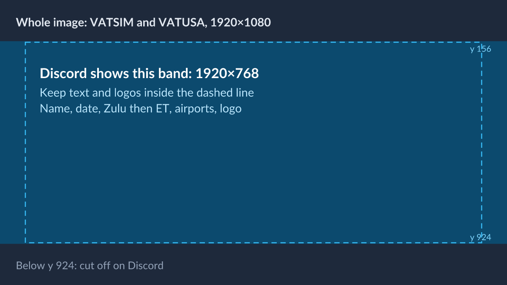
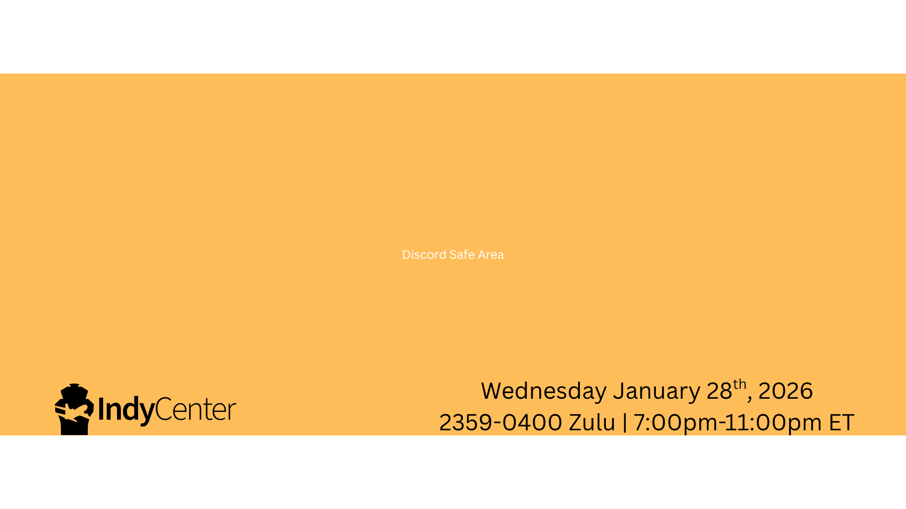

# Events

For the events team: how to make an event's banner and write its
description, so every event looks like Indy Center wherever it's posted.

## Where events go

Each event is posted to three places, with the same banner and the same
text, trimmed to fit:

- **VATSIM** (my.vatsim.net events)
- **VATUSA** (the division's event calendar)
- **Discord** (a scheduled event in the Indy Center server)

VATUSA's events policy (DP003) asks for the event to be final **4 weeks**
ahead and on VATSIM **14 days** ahead. Check the current policy before you
plan.

## The event banner

Make **one banner at 1920×1080** (16:9), PNG or JPG, under 8 MB. VATSIM and
VATUSA show the whole image. Discord shows only the **middle band, 1920×768**,
and cuts off the top and bottom.

So keep **all text and logos inside the Discord band**, with about 96 px
clear at the left and right.

Start from the template:

[Download the template](images/events-banner-template.png)

### What every banner shows

- The **event name**.
- The **date**.
- The **start and end times in Zulu**, then the same times in Eastern:
  "2359–0400 Zulu | 7:00–11:00 PM ET".
- The **airports** by ICAO code, where the event features any: KIND, KCVG,
  KSDF.
- The **logo**, inside the band. Use white on dark images and black on light
  ones (see [Marks](marks.md)).

For an event **co-hosted** with another ARTCC or a partner, show both logos
at the same height, side by side.

An event that starts at **midnight Zulu** may be written as starting at
**2359Z the day before**. 0000Z falls on the next Zulu day, so writing 2359Z
keeps the Zulu date the same as the date most members see that evening.

### On flyindycenter.com

The site's events list shows each banner as a narrow strip, cropped to the
middle. Text near the top or bottom won't show there, so make the banner's
picture work on its own too.

## The event description

Use the same text on every platform, in this order:

1. **A one-line hook.** What makes this event worth flying or controlling.
2. **What and where.** The airports, by ICAO code and name.
3. **When.** Zulu with a "Z"; in Discord, a timestamp tag as well, so each
   reader sees their own time (see [Voice and writing](voice.md)).
4. **Who it's for.** Pilots, controllers, or both, and any experience needed.
5. **Links.** Routes, charts, booking, the event on the other platforms.

If there's more to say, such as a partner involved, a giveaway, or other
news, add a short note at the end.

Event posts don't need the disclaimer.

### Text limits

| | Name | Description |
| --- | --- | --- |
| VATSIM | — | A short description of about 280 characters, then a full one in Markdown |
| VATUSA | Up to 240 characters | Markdown, no set limit |
| Discord | Up to 100 characters | Up to 1,000 characters |

Write the hook and the first lines so they work alone when a platform cuts
the rest.

## Event names

Keep them **brief and catchy**: two or three words is plenty. Write VATUSA's
own event names, such as FNO, as VATUSA writes them.
