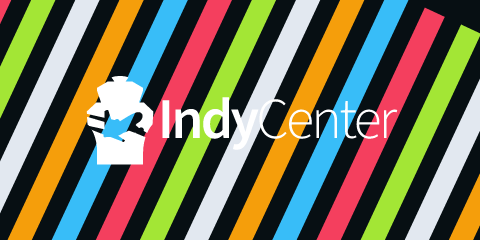

# Marks

Indy Center has two marks for everyday use, the **logo** and the **mark**,
plus **special marks** for occasions. Download them from [Downloads](downloads.md).

## The logo and the mark

The **logo** is the mark with the name beside it. Use it wherever there's
room: headers, banners, title cards, documents.

The **mark** is the tower on its own. Use it where space is small or square:
profile pictures, favicons, watermarks, the corner of a stream overlay.

Each comes in **white** and **black**, and nothing else.

## Choosing white or black

- **White on dark backgrounds, black on light ones.**
- **On a photo,** use whichever contrasts better with the area behind it.
- **If neither reads,** put a dark band or a blur behind the logo. Don't add
  an outline or a shadow.

## Clear space and size

These are recommendations, not hard rules.

- **Clear space:** keep the space around the mark or logo empty for at least
  half the mark's width on every side.
- **Smallest size:** the mark at least 24 px tall on screen; the logo at
  least 120 px wide, because "Center" is thin and fades out below that.

## Don't change them

Use the files as they are. Please don't:

| | |
| --- | --- |
|  | **Recolor it.** White or black only. |
|  | **Stretch or squash it.** Scale it evenly. |
|  | **Add an outline or a glow.** |
|  | **Add a shadow.** |
|  | **Rotate it.** |
|  | **Put it where it can't be seen.** Black on dark, white on light. |
|  | **Put it on a busy background** without a band behind it. |

Also don't redraw it, rearrange the mark and the name, or set the name in
another font.

## Special marks

A **special mark** is a version of the mark for an occasion, such as Pride
or the Kentucky Derby: the tower in special colors, or with a simple added
design.

- Use each one **only around its occasion**. The rest of the year, use the
  standard mark.
- Special marks keep **their own colors**. Use them as supplied.
- They are almost always the mark alone, without the name.
- **Indy Center** uses them. A **partner** may use one only with the brand
  owner's OK.

Special marks are in [`special/`](../special/), one folder per occasion.

<!-- Each special mark gets a row here when it's added: name, occasion, when to use it. -->

## Questions

Anything this page doesn't cover goes to the brand owner: the ATM, at
[atm@flyindycenter.com](mailto:atm@flyindycenter.com).
