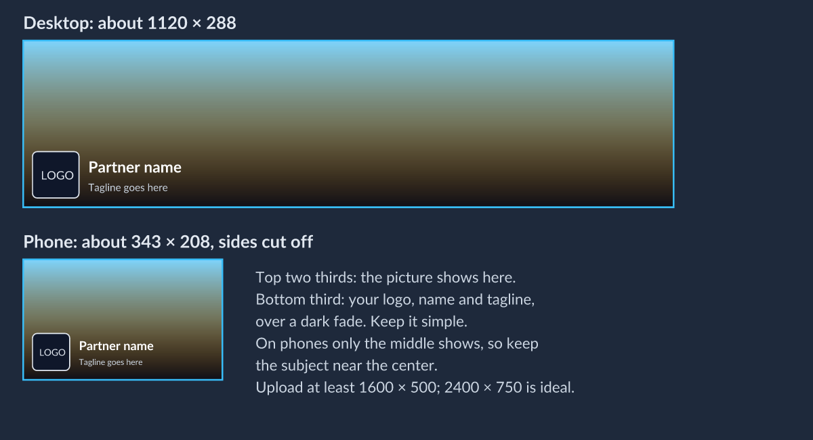
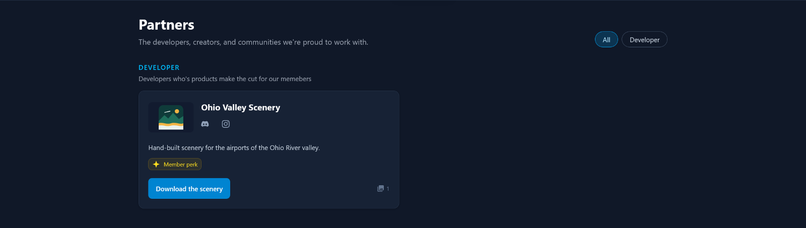
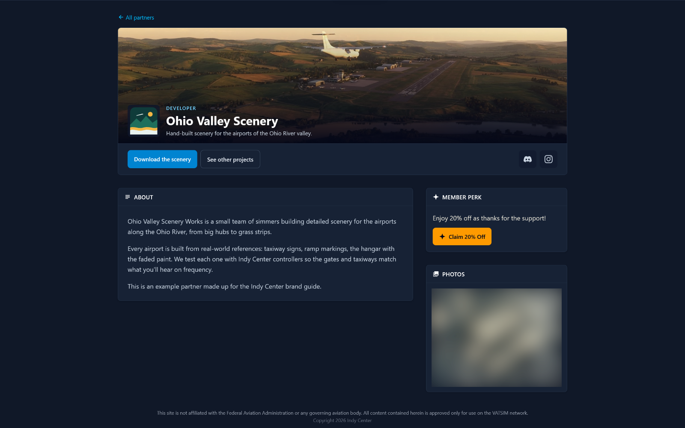
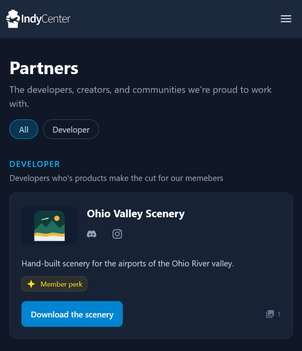
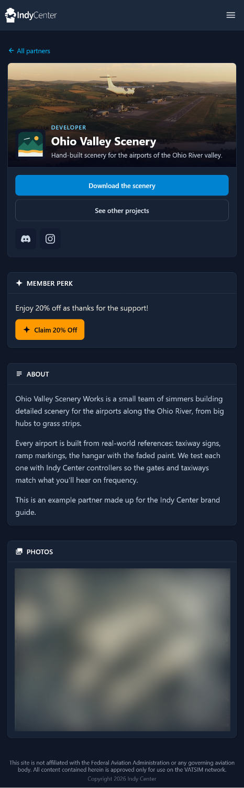
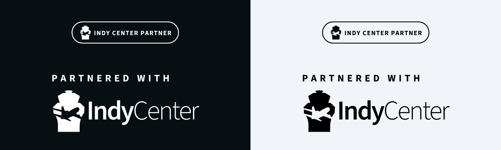

# Partners

Indy Center works with developers, creators and community groups, and shows
them on the [partners page](https://flyindycenter.com/partners). This page is
for partners: how to get your page, and how to mention Indy Center on your own
channels.

## Getting your partner page

Email [atm@flyindycenter.com](mailto:atm@flyindycenter.com) with the items
below. An Indy Center staff member puts your page together and lets you know
when it's live. Changes later work the same way: email what you'd like
changed.

### What to send

| Item | Needed? | Details |
| --- | --- | --- |
| **Name** | Yes | As you want it shown. |
| **Logo** | Yes | Square, at least 256×256. SVG, PNG or WebP, with a transparent background if you have one. |
| **Tagline** | Yes | One line, up to 120 characters, shown under your name. |
| **About** | Yes | A few short paragraphs about who you are and what you make. Plain text; no formatting. |
| **Calls to action** | Yes, one to three | Buttons that send visitors somewhere. For each, a short label ("Visit website", "Download the scenery") and the link. The first is the main one, shown on your card on the partners page. |
| **Social links** | Optional | Links to your Twitch, YouTube, Discord, X, Instagram, TikTok, Facebook, GitHub, or another website. Each shows as that platform's icon. |
| **Banner** | Optional | A wide header image, at least 1600×500. See [Your banner](#your-banner). Without one, your page uses a plain gradient. |
| **Photos** | Optional | Screenshots or photos of your work, for a gallery on your page. |
| **Member perks** | Optional | Something only Indy Center members get, such as a discount code. For each, a short label, what members get, and the link. Only signed-in members see it; everyone else is invited to join. |

Every image can be up to 10 MB.

### Your logo

Your logo appears small: in a square on your card and in the corner of your
banner. Send a version that reads clearly at that size, usually your symbol
on its own rather than a long wordmark. It sits on a dark background.

### Your banner

The banner is the header photo across the top of your page. Your logo, name
and tagline sit over its lower part, on a dark fade, and phones show only the
middle of it.

- Keep the subject in the **upper middle** of the image.
- Leave the **bottom third** simple: it's covered by your logo and name.
- Expect the **left and right sides to be cut off** on phones.
- Don't put text in the banner; your name and tagline are already there.

### Photos

Photos show as a featured image with thumbnails under it, and open full
screen. The featured image is shown at 4:3 and thumbnails as squares, so
keep the subject near the middle. Landscape images of 1600 px wide or more
look best.

### What your page looks like

Your card on the [partners page](https://flyindycenter.com/partners), and
your own page, shown here for a made-up example partner. Signed-in members
see the member perk; everyone else is invited to join Indy Center instead.

On a phone, the card and page stack into one column, and the member perk
moves above About.

| The card | The page |
| --- | --- |
|  |  |

## Mentioning Indy Center

We're glad when partners tell their audience about us. A few guidelines keep
it clear for everyone.

### What to say

- "**<Your name> is an Indy Center partner.**"
- "**Partnered with Indy Center.**"
- Write the name as two words, **Indy Center**. See
  [Name and terms](name-and-terms.md).
- Link to **your partner page** (`flyindycenter.com/partners/<your-page>`) or
  to **[flyindycenter.com](https://flyindycenter.com)**.

### What to show

- The **partner badge**, made for exactly this. It comes in two versions:
  the compact **partner badge** for overlays, panels and store pages, and
  **partnered with** for larger spaces such as credits or a website footer.
  Each comes in white and black.

  

- Or the **logo** or **mark**, as they are. See [Marks](marks.md).
- Download them from [Downloads](downloads.md).

Please don't edit them, put them in your own logo, or use a
[special mark](marks.md#special-marks) without the brand owner's OK.

### Keep it accurate

- The partnership is between you and Indy Center. Don't suggest that Indy
  Center endorses everything you make, or that **VATSIM or VATUSA** is part
  of it.
- If you offer a member perk, describe it as **for Indy Center members**.

### Questions

Ask the brand owner: the ATM, at
[atm@flyindycenter.com](mailto:atm@flyindycenter.com).
